<h1 align="center">Triumph</h1>

<p align="center"><b>An Xbox Series title running natively on Windows, on an NVIDIA card,<br>
and the work of getting its world to 30 frames a second.</b></p>

<p align="center">
  
  
  
  
</p>

<p align="center">
  
  
  
  
</p>

<table align="center">
  <tr>
    <td align="center"><a href="PLAN.md"><b>🗺️ The plan</b></a><br><sub>phases, gates, live log</sub></td>
    <td align="center"><a href="docs/tasks.md"><b>✅ Task log</b></a><br><sub>what's done, and what it measured</sub></td>
    <td align="center"><a href="docs/research/README.md"><b>🔬 Research</b></a><br><sub>the path to 30, 60 and 120</sub></td>
    <td align="center"><a href="docs/design/README.md"><b>📐 Designs</b></a><br><sub>plans for the big changes</sub></td>
    <td align="center"><a href="docs/runs.md"><b>📊 Every run</b></a><br><sub>including the rejected ones</sub></td>
    <td align="center"><a href="docs/tooling.md"><b>🧰 Tooling</b></a><br><sub>how we measure and debug</sub></td>
    <td align="center"><a href="docs/credits.md"><b>🙏 Credits</b></a><br><sub>code we used, and who wrote it</sub></td>
  </tr>
</table>

---

Triumph is a fork of VIctory (Marvisak), a compatibility layer that runs
an Xbox Series title's own x86-64 code on Windows and supplies everything underneath it: the console's
system calls, its memory model, and its GPU, translated to Direct3D 12. This fork has one job: **make
the 3D world playable on one specific PC without losing picture or correctness.**

> [!IMPORTANT]
> This repository contains no game files, code or assets. You need your own copy of the title.
> Nothing here is affiliated with or endorsed by its developer or publisher.

## 📍 Where it stands

Measured on one machine (i7-10700KF, RTX 4070 Ti 12 GB, 64 GB RAM, Windows 11), world scene,
diagnostics build, confirmed launch settings.

| | now | target |
|:--|:--|:--|
| **Frame rate** | **7.9 fps · 127 ms** median, 8.8 fps best | 30 fps |
| **Scene drawn** | **~4,800 draws** a frame, ~360 dropped | 0 dropped |
| **Shaders** | **25,636 / 25,694** translate (99.77 %) | all |
| **Pipelines refused** | **7** (was 311) | 0 |
| **Crashes** | 0 in the measured runs | 0 |
| **Resolution** | 2560×1440 scene, output 3840×2160 | lower scale + DLSS |

Every result is reported as **fps · ms · draws · dropped** together. A faster frame that draws less of
the scene is not a win. Runs of the same build vary by ~7 %, so smaller gains are measured inside one
run.

## ⏱️ Where a frame goes

```mermaid
gantt
    title One ~127 ms world frame today
    dateFormat X
    axisFormat %L
    section Title
    render thread works        :0, 6
    waits for us in present    :6, 74
    section Our layer
    copies (72 MB)             :0, 24
    copy-back (56 MB)          :24, 67
    other submit work          :67, 74
    section GPU
    our hash and compare lists :0, 26
    the title's own work       :26, 71
    idle                       :71, 115
```



The title isn't the bottleneck. **Our layer's memory mirroring is.** The console has one memory that
CPU and GPU share; this layer copies the title's graphics memory to the card every frame and copies the
GPU's writes back. [Zero-copy memory](docs/design/uma.md) removes that, after which the GPU becomes the
limit.

## 🗺️ The plan

| | step | why | status |
|:--:|:--|:--|:--:|
| 1 | **Overlap the title's frame with ours** (`VICTORY_ASYNC_PRESENT`) | the two phases run one after the other today | 🔄 measuring |
| 2 | **Zero-copy memory**: the GPU uses title memory directly | removes ~35–65 ms of CPU and ~20 ms of GPU work a frame | 📐 [designed](docs/design/uma.md) |
| 3 | **The last dropped draws**: wave64 shaders, the 58 untranslated programs | the full scene | 🔄 1 of 7 done |
| 4 | **Card-side cost**: indirect/dispatch structure, memory emulation, native wave ops | the GPU's ~45 ms | 🔬 [researched](docs/research/native-60-gpu.md) |
| 5 | **Lower render scale + DLSS** in place of the title's FSR | halves the GPU's pixel work | 📐 [designed](docs/design/dlss.md) |
| 6 | **DLSS Frame Generation** | smoother, not faster, so it's last | ⏳ |
| 7 | **Debug menu**: overlay, switches, teleport, spawning | testing, after a stable 30 | 📐 [designed](docs/design/debug-menu.md) |

Full status with outcomes: **[task log](docs/tasks.md)**.

## 🔎 Recent findings

- **311 pipelines were refused because of an earlier "fix".** The D3D12 debug layer showed the
  shaders index the sampler heap directly, and the flag allowing that had been removed. Restoring it
  took refusals from 311 to 7 and the scene from 3,962 to 4,706 draws.
- **`fsrQuality=4` works now.** It was black only because its passes were among the refused pipelines.
- **96 % of copied-back memory is never read by the title.** That makes dropping copy-back the first
  step of zero-copy.
- **Measurements need a quiet machine.** A background build during one run made the same build read
  2.3 fps instead of 7.3.

## ▶️ Running it

Requirements: Windows 10/11 x64, a CPU with AVX2, a Direct3D 12 GPU with shader model 6.6 and mesh
shaders, Rust (pinned in `rust-toolchain.toml`), and several GB of free Windows commit.

```powershell
copy victory.example.toml victory.toml        # set your game and data paths (outside the repo)
cargo test --workspace                        # needs no game data
cargo run -p victory -- config                # check your paths
cargo build --profile diag --features diagnostics -p victory
target\diag\victory.exe run <game dir>\<the title's exe> --execute
```

The window caption shows the frame rate. With no pad connected, the keyboard acts as one: W A S D /
I J K L sticks, arrows D-pad, Enter / Backspace / X / Y face buttons, Q / E shoulders, Z / C
triggers, Esc / Tab Menu / View.

<details>
<summary><b>Diagnostics switches</b></summary>

| variable | effect |
|:--|:--|
| `VICTORY_D3D12_DEBUG=1` | D3D12 debug layer; names why a pipeline or command is rejected |
| `VICTORY_D3D12_DRED=1` | on a GPU fault, what was running |
| `VICTORY_CAPTURE=<dir>` | saves presented frames |
| `VICTORY_LOG=<target>=debug` | more logging |

The full list is in upstream's README.
</details>

## 📚 Documentation

| | page | what it holds |
|:--:|:--|:--|
| ✅ | [Task log](docs/tasks.md) | done, in progress, next, each with its outcome |
| 🔬 | [Research](docs/research/README.md) | four reports on reaching 60/120, native paths, caching and shader cost |
| 📐 | [Designs](docs/design/README.md) | zero-copy memory, DLSS, per-lane translation, debug menu |
| 📊 | [Runs](docs/runs.md) | every measured run, including the rejected ones and why |
| ⚙️ | [Settings](docs/settings.md) | the title's own settings file and what each change measured |
| 🧰 | [Tooling](docs/tooling.md) | the tools and scripts we measure with, and what each found |
| 🙏 | [Credits](docs/credits.md) | every project we used or learned from, and what came from each |
| 🤝 | [CLAUDE.md](CLAUDE.md) | the working handoff: measured state, blockers, rules |

## 🙏 Credits

The full list, with what came from each project: **[credits](docs/credits.md)**.


- **VIctory (Marvisak)** by Marvisak and contributors is the base of
  everything here: loader, runtime services, the Direct3D 12 back end, the shader recompiler.
- **the X reference layer** (ivall) by ivall and contributors is a design reference: its unified
  memory and wave64-on-wave32 designs. the X reference layer is GPL-2.0-only and this fork is GPL-3.0, so its ideas
  are reimplemented here, never copied.
- **the RDNA3 reference fork** and its contributors for its documented cost structure and the decoder fix from
  its PR #6 (Yoshi-233, after davutsimsekk / Belobug).
- The guard over every view of a memory page is by **myokex** (an AMD memory fork, `c6dc4d8`), adapting
  pull request #115 by Spexivus, its correction by joroyt and part of VIctory #1122 by tightfall. The
  read-beside fix for kernel reads is by **Joshua Odom** (`10ea38e`).
- Developed with [Claude Code](https://claude.com/claude-code) and Hermes Agent. Figures on this page
  were measured on the machine described, not estimated.

## ⚖️ License

GPL-3.0-or-later, as VIctory. See [LICENSE](LICENSE).
