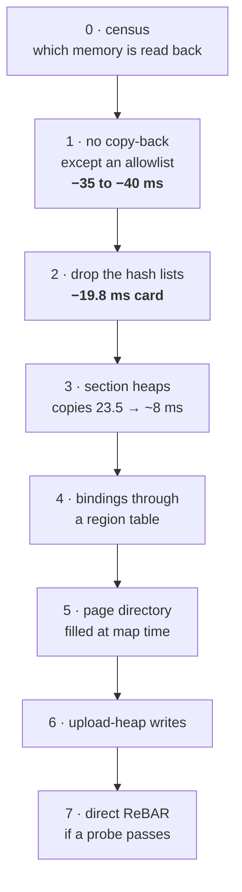

<h1 align="center">📐 Designs</h1>

<i>The plans for the big changes, written before the code.</i>

<a href="../../README.md">← Back to Triumph</a> · <a href="../research/README.md">Research</a> · <a href="../tasks.md">Task log</a>

---

Every design lands in steps, each behind its own `VICTORY_*` switch that is off by default. Each step
is measured against the previous one (fps · ms · draws · dropped, plus a screenshot) before the next
begins.

| | design | what it changes | expected | effort | status |
|:--:|:--|:--|:--|:--|:--:|
| 🧠 | [**Zero-copy memory (UMA)**](uma.md) | Title memory used by the GPU directly, so the per-frame copy, hash and copy-back machinery goes | −35 to −65 ms submit thread, −20 ms card; ends card-bound at ~50–55 ms | weeks | ⏳ next big item |
| 🖼️ | [**DLSS in place of FSR**](dlss.md) | Hook the title's FidelityFX loader (5 exports) and drive DLSS from the same inputs | GPU time down 10–20 ms in performance mode; little fps until zero-copy lands | days | ⏳ after UMA |
| ⚡ | [**Per-lane and native wave ops**](per-lane.md) | Native quad ops, folded lane indices, reduction ladders and flat regions in the translator | a few ms of card time; settles the 4–8× question first | weeks, staged | ⏳ |
| 🎮 | [**Debug menu**](debug-menu.md) | In-game overlay, live switches, shader-skip picker, viewers; later teleport and spawning | testing speed, not fps | 3–4 weeks (layer tools) | 💤 after stable 30 fps |

## How the big one lands

Licensing notes are in each design. In particular, DLSS is a closed SDK and this repository is
GPL-3.0, so how it ships is the owner's decision. xcl (GPL-2.0-only) is read for ideas only, never copied.
