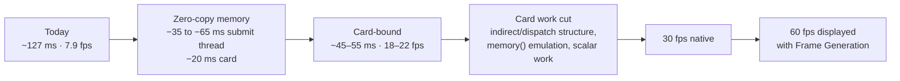

<h1 align="center">🔬 Advanced research</h1>

<i>Where the frame time goes, what could remove it, and how far this machine can go.</i>

<a href="../../README.md">← Back to Triumph</a> · <a href="../design/README.md">Designs</a> · <a href="../tasks.md">Task log</a>

---

Each report was written by a read-only research agent against the code and the measured runs in
[runs.md](../runs.md). They were not checked line by line, so treat a report's estimates as
estimates. Every report marks what it verified apart from what it guessed. Where two reports
disagree, the disagreement is listed below rather than smoothed over.

## Reports

| | report | question it answers | headline |
|:--:|:--|:--|:--|
| 🎯 | [**Path to 60 and 120 fps**](path-to-60-and-120.md) | What beyond the current plan gets us to 60, then 120? | Overlapping the title's frame with ours (`VICTORY_ASYNC_PRESENT`) is the biggest untested lever. On this card, the GPU is the wall at ~45 ms even after all planned work. |
| 🧮 | [**Native 60 fps on the GPU**](native-60-gpu.md) | Why does the title's GPU work cost ~45 ms here, and how is it recovered without upscaling? | The "3× less efficient" premise is soft (closer to 1.65× for this integer-heavy code). Cost is a flat tail of ~1,290 kinds of work. The biggest card-side cost is the structure around indirect draws and dispatches. |
| 🧩 | [**Running parts natively**](native-paths.md) | What could bypass emulation instead of speeding it up? | No PC shaders or PC build ship with the title, so translation stays. The real bypasses are memory living on the card, the upscaler hook, and GPU-side texture detiling. |
| 💾 | [**Caching**](caching.md) | Which caches cut load time, stutter and frame time? | Cheapest wins: warm the shader cache after each translator change, preload the working set into RAM. The NVIDIA driver cache is 32 GB and worth investigating. |

## What the reports agree on

- **Our layer's memory mirroring is the wall today**, not the title or the GPU.
- **After that, the GPU is the wall**, and no single shader fix recovers the gap.
- **Native 60 fps is a stretch on this hardware.** 60 fps *displayed* via Frame Generation on a real ~30 is plausible. Real 120 is not.

## Open disagreements

| topic | one view | other view | settles it |
|:--|:--|:--|:--|
| Cost of masked lanes | `per-lane.md`: 4–8× on hot shaders | census: 16.5 % of instructions, 2.4 % guarded | a per-shader card-time join (cardmeter + census) |
| Title's GPU efficiency | "~3× worse than console" | ~1.65× once integer work is counted | PIX / Nsight timing of the top pipelines |
| Value of THIN | 75 → 68 ms on another fork | 0.0 ms of recording on our render thread | a run with THIN that shows *present* shrinking |
