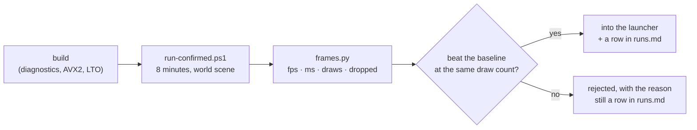

<h1 align="center">🧰 Tooling</h1>

<i>The tools we measure and debug with, why we used each one, and what it found.</i>

<a href="../README.md">← Back to Triumph</a> · <a href="credits.md">Code we used</a> · <a href="tasks.md">Task log</a>

---

Anyone working on a console compatibility layer hits the same wall: a frame is thousands of
translated draws, and "it's slow" or "it's black" says nothing about why. These are the tools that
turned guesses into numbers here, in the order they paid off.

## The measurement loop

| script | what it does |
|:--|:--|
| [`scripts/measure/run-title.ps1`](../scripts/measure/run-title.ps1) | launches the title under the diagnostics build, logs the run, and moves the window aside. `-Game` or `VICTORY_GAME_EXE` is your own copy. |
| [`scripts/measure/run-confirmed.ps1`](../scripts/measure/run-confirmed.ps1) | the **confirmed switch set** only, 480 s. Every switch in it measured a win. |
| [`scripts/measure/frames.py`](../scripts/measure/frames.py) | reads a run log and prints median and best **fps · ms · draws · dropped** for world frames. With `--check-cpu` it warns when the run was starved of CPU. |
| [`scripts/measure/winshot.ps1`](../scripts/measure/winshot.ps1) | screenshots the title's window, even when covered. Use it for anything that changes the picture. |

**Lessons the loop taught us:**
- A run is only fair on a quiet machine. A background build made the same exe read 2.3 fps instead of
  7.3, and `frames.py --check-cpu` now catches that.
- Two runs of one build differ by ~7 % (the scene changes), so smaller gains are measured *inside one
  run* with `alt` switches that flip every 20 s.
- The world takes 2–4 minutes to load, and frames before it are menus. Eight-minute runs give ~50 world
  samples, which is enough.

## The tools

| | tool | why we used it | what it found here |
|:--:|:--|:--|:--|
| 🐞 | **D3D12 debug layer** (`VICTORY_D3D12_DEBUG=1`) | 311 compute pipelines failed with a bare `E_INVALIDARG` | It named the cause in one run: *"Shader uses sampler descriptor heap indexing, but root signature is missing … SAMPLER_HEAP_DIRECTLY_INDEXED"*. An earlier "fix" had removed that flag. Restoring it took refusals **311 → 7** and the scene **3,962 → 4,706 draws**. It also named the 7 that remain (*"wants wave lane count of 64"*). |
| 📊 | **Shader census** (`victory translate --list`) | We needed a coverage number we'd produced ourselves | **25,636 / 25,694** programs emit DXIL, plus the 58 refusals ranked by reason, which set the order of work. |
| 🧾 | **Frame account** (the diagnostics build's `usual frame` line) | To see where a frame goes, not guess | The title waits **~68 ms** in present for our layer, and the card is **idle 44 ms**. Our memory mirroring is the wall, not the GPU, which put zero-copy first. |
| 🏷️ | **GPU event markers** (`VICTORY_MARKERS=1`) | A capture of our process was 4,800 anonymous draws | Every draw and dispatch is named by shader hash, and our own copies, copy-back and present are labelled. |
| 🎯 | **Capture trigger** (`VICTORY_CAPTURE_TOOL=renderdoc\|pix`, `VICTORY_CAPTURE_AT=<frame>` or F11) | To grab exactly the world frame we need | — in use from the next runs |
| 🖼️ | **[RenderDoc](https://renderdoc.org/)** | Step to the draw that writes wrong pixels and inspect its inputs and shader | — next: the red block artefacts on character clothing |
| ⏱️ | **[PIX](https://devblogs.microsoft.com/pix/)** timing captures | GPU time per pass, and our submit thread's CPU timeline | — next: where the card's ~71 ms goes |
| 📈 | **[Nsight Systems](https://developer.nvidia.com/nsight-systems)** | CPU+GPU timeline across threads and queues | — next: shows whether the title's frame and ours overlap (`ASYNC_PRESENT`) |
| 🔬 | **[Nsight Graphics](https://developer.nvidia.com/nsight-graphics)** | Per-shader stall reasons on an NVIDIA card | — next: why translated shaders cost what they do |
| 💥 | **[Nsight Aftermath](https://developer.nvidia.com/nsight-aftermath)** | Which shader was running when the GPU crashed or hung | — wired in only when a crash needs it (loaded at runtime, not shipped) |
| 🧪 | **Shader stub** (`VICTORY_SHADER_STUB=1`) | Measures the GPU-time floor of our layer's structure with the pixel and compute shaders made empty | — next run |
| 🪟 | **Screenshots** (`winshot.ps1`) | A frame counter can read 7 fps while the picture is black | Confirmed `fsrQuality=4` renders on the fixed build, and found the red block artefacts. |

Rows marked "—" are tools now in place whose findings land in the [task log](tasks.md) as they come in.

## Licences

RenderDoc is MIT-licensed. PIX, the Nsight tools and the Aftermath SDK are free but closed NVIDIA and
Microsoft software. **None of them ship in this repository.** The code only loads them at runtime from
where you installed them, when you ask for them with a switch.
